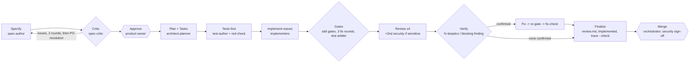

# {{PROJECT}} development workflow

Status: **Draft**. Rules: `docs/CONSTITUTION.md`. Configuration: `sdd.config.json`. Kit
reference: the agentic-sdd-kit `docs/PLAYBOOK.md` and `docs/LESSONS.md`.

{{PROJECT}} is built largely by AI coding agents. A main Claude Code session, the
**orchestrator**, runs one workflow per feature in that feature's git worktree. Specialised
subagents write the spec, tests and code; other subagents review and attack the result. The
workflow is **spec-anchored on the normative source**: source sections lead to atomic
requirements with stable ids, then tests, then code, then gates, reviews and independent
evidence. Every link is checked by `sdd trace`.

Two principles shape everything below:
1. **What must always happen is a hook, a gate or a tool, not a prompt.** CLAUDE.md and
   agent prompts are guidance. Protected paths, formatting, gates, counts and traceability
   are enforced deterministically.
2. **Agents optimise against their checks, so checks are independent of the agent being
   checked.** Tests come from a different agent than the code, oracles come from outside the
   codebase, and reviewers have fresh context and read-only tools. Skeptical verifiers filter
   reviewer false positives.

---

## 1. Roles

| Agent (`.claude/agents/`) | Tier | Tools | Stage(s) | Writes |
|---|---|---|---|---|
| orchestrator (main session) | session | all | drives the pipeline; **product owner** by default; security sign-off | spec `Status: Approved`, merges |
| `product-owner` | strong | file tools | Approve (autonomous mode), spec resolution, exceptions | `specs/features/**` |
| `spec-author` | strong | file tools + Bash | Specify, critic fixes | `specs/features/**` (hook) |
| `spec-critic` | strong | read-only + Bash | Critic | nothing |
| `architect-planner` | strong | file tools + Bash | Plan | `specs/features/**` (hook) |
| `test-author` | strong | file tools + Bash | Tests, test fixes, test-defect triage, arbitration | tests, skeletons, *new* fixtures |
| `implementer` | mid (top on retry) | file tools + Bash | Implement, gate fixes, review fixes, semantic merge resolution | product code (not test paths) |
| `integrator` | mechanical / mid | file tools + Bash | setup, commits, merges, gate runs, finalize | `specs/features/**`, lockfiles (hook) |
| `spec-compliance-reviewer` | strong | read-only + Bash | Review | nothing |
| `security-reviewer` | strong | read-only + Bash | Review (x2 if security-sensitive) | nothing |
| `test-adequacy-reviewer` | mid | read-only + Bash | Review | nothing |
| `perf-reviewer` | mid | read-only + Bash | Review | nothing |
| `verifier` | strong | all file tools, in a throwaway worktree | Verify, fix checks (x2 if security-sensitive) | throwaway tests, always discarded |

Model ids per tier come from `models` in `sdd.config.json` (explicit ids, never aliases).
The `top` tier is used only for the hardest cases: a fix that already failed once, test
arbitration, the second product-owner resolution pass, and features flagged `hard`.

## 2. Artifacts

```
<normative source dir>            read-only corpus (standard texts / contracts / requirements)
specs/templates/                  spec.md, design.md, tasks.md, review.md
specs/features/NNN-slug/
  spec.md                         what: refs, scope, requirements, scenarios, abnormal cases, observability, decisions
  design.md                       how: modules, state machines, types, sequences, perf, security, test strategy, constitution check
  tasks.md                        waves of tasks with files, verifies, depends, [P]
  review.md                       gates, findings, verifier votes, sign-offs
<test paths>                      tests (test-author); fixtures append-only
.sdd/logs/                        gate logs (GATES_EXIT marker at the end of each)
.wt/<FID>/                        per-feature worktrees (git-ignored)
tools/sdd/pipeline/feature-pipeline.js   the per-feature workflow (tracked, unprotected)
```

Numbering, the `Status:` lifecycle and naming are in `specs/features/README.md`.

## 3. Lifecycle at a glance



## 4. Status model

`spec.md` has `Status: Draft -> Approved -> Implemented`. `sdd trace --check` enforces
implementation and test coverage of `must` requirements only for the statuses listed in
`requirements.enforce_for_statuses` (default: Implemented), so a Draft never breaks CI.

---

## 5. Stages

### 5.1 Specify
- **Agent:** `spec-author`. **Entry:** the feature is in the roadmap and its dependencies are
  merged; the feature directory is scaffolded (`sdd new-feature`); the worktree
  `.wt/FNNN` is on branch `feat/FNNN-slug`.
- **Work:** read every in-scope source section (plus abnormal cases); one atomic requirement
  per normative sentence in the exact line format, within this feature's id block and the
  requirement budget; acceptance scenarios; abnormal-case table; observability; security
  considerations; decisions for project-internal choices; clarification markers only for
  genuine source ambiguity.
- **Exit:** spec.md complete, `Status: Draft`.

### 5.2 Critic
- **Agent:** `spec-critic` (read-only). Fixes go back to `spec-author`.
- **Loop:** round 1 calibrates severity; later rounds are *convergence rounds* (re-check
  earlier issues, raise only new blocking ones). At most `pipeline.max_critic_fix_rounds`
  fix rounds. If blocking/major issues remain: with `approval: "agent"` the `product-owner`
  resolves (decide, cut scope, defer; up to 2 passes, each followed by a blocking-only
  check); otherwise the pipeline stops with `blocked-spec` for the orchestrator.
- **Exit:** no blocking/major issue. Committed as `docs(FNNN): draft spec ...`.

### 5.3 Approve (human-in-the-loop point #1)
- **Agent:** the product owner: the orchestrator (default; the pipeline returns
  `awaiting-approval`) or the `product-owner` agent (`approval: "agent"`; a rejection
  triggers one `spec-author` fix pass and a re-review).
- **Checklist:** scope matches the roadmap; proportionate count; `sdd spec-info` reports zero
  open clarification markers, with decisions recorded; every in-scope abnormal case covered
  or out of scope; every `must` in a scenario; critic clean. **Never** approve by inventing
  normative behaviour.
- **Exit:** `Status: Approved`, committed as `docs(FNNN): approve spec`. Requirement ids are
  frozen from here on.

### 5.4 Plan and tasks
- **Agent:** `architect-planner`. **Work:** design.md (modules, state machines, sequences,
  types, events, errors, performance, security, test strategy, constitution check,
  exceptions); tasks.md in waves in the exact line format; security-sensitive flag.
- **Exit:** `sdd tasks <dir> --validate` is clean: every requirement covered by a task,
  dependencies point to earlier waves, `[P]` tasks in a wave have disjoint files. Committed
  as `docs(FNNN): design and tasks`.

### 5.5 Tests first
- **Agent:** `test-author`; the red check is run by `integrator`.
- **Work:** tests tagged with requirement ids for every scheduled requirement; abnormal
  cases; time via the test clock; event assertions; new fixtures with provenance; property
  and fuzz tests for parsers; minimal skeletons so everything compiles.
- **Red check (exit):** everything compiles; the new tests fail for the right reason;
  `sdd trace --feature NNN` shows no `must` without a test. Unexpected passes are recorded.
  Committed as `test(FNNN): failing tests ...`; that SHA is the **tests baseline**.

### 5.6 Implement (waves; isolation policy)
- **Agent:** `implementer`, one per task, or one per lane in worktree mode.
- **Isolation:** tasks in a wave are grouped into **lanes** by component overlap
  (`components.path_regex`). One lane: tasks run sequentially in the feature tree. Several
  lanes (disjoint components): lanes run concurrently, each in its own worktree branched
  from a committed base; the integrator merges them with `--no-ff`. Manifest conflicts are
  resolved by `sdd union-merge` (additive manifests only); any other conflict is resolved
  **semantically by an implementer agent**, never by union, never by abort-and-hope.
- **Failures:** one automatic retry per task (top tier) with the failure fed back; then
  `blocked-implement`. Done tasks stay `[x]`, so a re-run resumes.
- **Test defects:** an implementer that believes a test contradicts the source reports it
  with the citation; `test-author` triages. Implementers cannot edit tests (hook).

### 5.7 Gates
- **Agent:** `integrator` runs them (detached, polled until `GATES_EXIT=<n>`); `implementer`
  fixes root causes, at most `pipeline.max_gate_fix_rounds` rounds. After two consecutive
  failing test gates, `test-author` **arbitrates** which side is wrong. A performance
  regression is never fixed by loosening the threshold: either it is removed or the pipeline
  records that a product-owner exception is needed. Infrastructure errors stop immediately
  with `blocked-infra`.

### 5.8 Review
- **Agents:** `spec-compliance-reviewer`, `security-reviewer`, `test-adequacy-reviewer`,
  `perf-reviewer`, in parallel, each read-only with a fresh context; a reviewer that returns
  nothing is retried once, a persistent gap blocks finalisation.
- **Security-sensitive changes** (plan or any reviewer) get a **second, independent
  `security-reviewer`** and need a product-owner sign-off before merge (human-in-the-loop
  point #2).
- Only `blocking` findings gate the merge; the rest are recorded in review.md.

### 5.9 Adversarial verify
- `pipeline.skeptics` independent `verifier`s per blocking finding, each experimenting only
  in a detached throwaway worktree. A finding is dismissed only if **every** skeptic that
  answered refutes it. Confirmed findings are fixed sequentially (code: implementer, tests:
  test-author), gates re-run, and a verifier fix-checks each ("is the root cause really
  gone?"); two independent fix-checks for security-sensitive features. Unresolved findings
  block.

### 5.10 Finalize and merge
- **Finalize (`integrator`):** write review.md from the pipeline record; set
  `Status: Implemented`; run `sdd trace --check --feature NNN` and `sdd trace --check`; on
  failure revert to Approved and report `blocked-finalize`; commit
  `docs(FNNN): mark implemented, review record`.
- **Merge (orchestrator):** record the security sign-off if required; merge `main` **into**
  the feature branch in its worktree, resolve conflicts (manifests by union, sources
  semantically), run full `sdd gates` there; then `git merge --no-ff feat/FNNN-slug` into
  `main` (conflict-free by construction); run `sdd trace --check` on main; delete the
  worktree's build output; remove the worktree.

---

## 6. Gates

`sdd gates [--fast]` is the single entry point; the gate list, commands and timeouts are
`gates.fast` / `gates.full` in `sdd.config.json`. The table below is the policy: what must
hold. Raise discrepancies as issues; never change thresholds silently (Article 12).

| Gate | Check | Threshold | `--fast` | full |
|---|---|---|---|---|
| fmt | <formatter check> | 0 diffs | yes | yes |
| lint | <linter with warnings as errors> | 0 warnings | yes | yes |
| test | <test runner> | 100 % pass; no new skipped tests | affected components | yes |
| trace | `sdd trace --check` | 0 orphan/duplicate ids; every `must` of an Implemented spec implemented and tested | current feature | yes |
| <oracle> | <fixtures / external validator / reference implementation> | all pass; existing fixtures unchanged | | yes |
| <fuzz> | <budgeted fuzzing of changed targets> | 0 crashes | | yes |
| <coverage / mutation> | <tool> | <thresholds> | | yes / nightly |
| <supply chain> | <audit / licence check> | 0 findings | | yes |
| <perf> | <benchmark vs recorded baseline> | <= N % regression unless a PO exception is recorded | | yes |
| review + verify | LLM reviewers and skeptics | 0 confirmed unresolved blocking findings | | pipeline |
| product owner | spec approval; security sign-off | recorded in commit / review.md | | pipeline |

Keep full gates fast enough to run per feature: budget fuzzing, test only changed targets,
use an optimised test profile for heavy property tests. Gate logs are in `.sdd/logs/`.

## 7. Oracles

<List the independent oracles the project uses (published vectors, external decoders,
reference implementations, contract tests, differential runs against another implementation)
and where their evidence goes.>

## 8. Guardrails (hooks, permissions, protected paths)

Configured in `.claude/settings.json`; logic in `tools/sdd/sddkit/hooks.py`, driven by
`sdd.config.json`:

| Hook | Event | Behaviour |
|---|---|---|
| `protect-paths.sh` | PreToolUse Edit/Write | blocks `protected_paths`, `append_only_paths` (listed roles may only create new files), `role_denied_paths`, and writes outside `role_write_scopes`. Paths resolve against the tree holding the file (worktree-safe). Fails closed on bad input. |
| `bash-guard.sh` | PreToolUse Bash | best effort: redirections and mutating commands naming protected paths; destructive git commands (`checkout -- <path>`, `restore`, `clean`, `reset --hard`, `stash`, force-push, `--no-verify`) everywhere. |
| `format.sh` | PostToolUse Edit/Write | runs the matching `formatters` entry; exit 2 with the parser error if the edit left invalid syntax. |
| `stop-check.sh` | Stop, SubagentStop | runs `stop_check.command` once when matching files changed; never loops. |

- **Override:** a human maintenance session: `SDD_ALLOW_PROTECTED=1 claude`
  (`SDD_ALLOW_DESTRUCTIVE_GIT=1` for the git rules). Agents never set these. The override
  also exists because the hooks bind the orchestrator; the live pipeline script therefore
  lives in the tracked, unprotected `tools/sdd/` directory.
- **Permissions:** `.claude/settings.json` allowlists the kit tools and read-only git; the
  deny list covers force-push, `--no-verify`, destructive git and `.env` files. Add the
  project's build/test commands to the allowlist.

## 9. Running the pipeline

The orchestrator uses the `/feature` skill, or calls the Workflow tool directly:

```js
Workflow({
  scriptPath: "<repo>/tools/sdd/pipeline/feature-pipeline.js",
  args: { feature: "F011", slug: "user-login", root: "<repo>/.wt/F011", config: <sdd config --pipeline> }
})
```

Arguments: `feature`, `slug` (required); `config` (the JSON from `sdd config --pipeline`;
loaded by a bootstrap agent when omitted); `root` (absolute worktree path; created from
`main` if missing); `stages`; `approval` (`"orchestrator"` default, `"agent"`); `isolation`;
`security: true`; `hard: true`; `notes`; `testsSha`; `findings`; `poResolved`; `models`,
`modelsFromPhase`, `modelsBefore` (tier changes on resume); `tiering: false`.

Statuses: `awaiting-approval`, `ready-to-merge`, `blocked-<stage>`, `paused` (an agent
failed twice: usage limit or outage; resume with `resumeFromRunId` and the same args),
`stopped`. Always read `nextAction`.

## 10. Quick path (bugfix, refactor, perf)

1. Write a regression test first (test-author, or the orchestrator for trivial fixes), tagged
   with the existing requirement id it violates. No requirement covers it: that is a spec
   gap, use the full path.
2. Fix the code with an implementer.
3. Run `sdd gates`.
4. Review with `/review-feature` or `stages: ["gates","review","verify"]`.
5. Commit `fix(<FNNN|component>): ...`.

Behaviour changes to Approved requirements always take the full path, with a new id that
supersedes the old one.

## 11. Human-in-the-loop points

| Point | Default actor (autonomous mode) | Escalate to a human when |
|---|---|---|
| Spec approval (5.3) | orchestrator or product-owner agent | scope conflicts with the roadmap; a source ambiguity needs a deviation with product impact |
| Security sign-off (5.8) | orchestrator, after the independent second security review and re-verified fixes | any confirmed crypto/integrity finding; any new key-handling design |
| Performance exception (5.7) | product owner, recorded in review.md | the budget itself needs to change (ADR) |
| Constitution, `.claude/`, `sdd.config.json` changes | none (agents are blocked) | always: human with `SDD_ALLOW_PROTECTED=1` plus an ADR |
| New dependency / module | architect-planner justification + review | licence not on the allowlist |
| Pipeline `blocked-*` after retries | orchestrator | the same feature blocks twice for the same reason |

## 12. Machine hygiene

- Never put build output or worktrees on a RAM tmpfs (`/tmp`); keep them under the project.
- Cap parallel build jobs per worktree (`pipeline.max_build_jobs`) and parallel features
  (`pipeline.max_parallel_features`).
- Delete build output after merging a feature; watch host disk before launching builds.
- Disable OS auto-updates / auto-restarts on the host during long runs.
