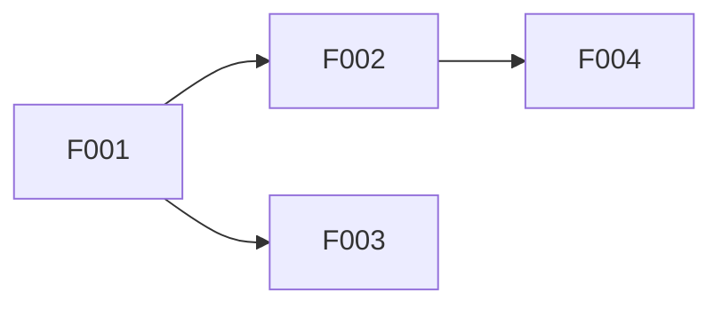

# {{PROJECT}} roadmap

Status: **Draft**. Owner: the architect. The roadmap owns feature numbers: `F<NNN>` is
unique and never reused, and the slug here is the slug of the feature directory and branch.
`sdd progress` and `sdd new-feature` parse the `### M<n> — <name>`, `### Cross-cutting — <name>`
and `#### F<NNN> <slug> — <title>` headings (regexes in `sdd.config.json` `features`). The title
after the slug is the feature's display name in `sdd progress` until its spec has an H1 title; a
trailing note such as `(placeholder, specs later)` or `(TBD)` is not shown. Features under a
cross-cutting heading belong to no milestone: `sdd progress` shows them as their own group and
counts them in the overall percentage only.

## 1. Milestones

| Milestone | Outcome | Features |
|---|---|---|
| **M0 Foundations** | <what works at the end of M0> | F001-F00x |
| **M1 <name>** | <outcome> | F0xx-F0yy |

## 2. Waves (concurrency plan)

Features that touch disjoint components can run in parallel, each in its own worktree. Keep
at most `pipeline.max_parallel_features` running.

| Wave | Features | Why they can run together |
|---|---|---|
| 1 | F001 | foundations, everything depends on it |
| 2 | F002, F003 | disjoint components |

## 3. Dependency graph

## 4. Features

### M0 — Foundations

#### F001 <slug> — <Feature title>
- **Goal:** <one sentence>
- **Scope:** <in-scope items with source sections>
- **Out of scope:** <items and the feature that owns them>
- **Acceptance criteria:** <observable results the spec's `must` requirements must cover; the
  spec budget is derived from these, not the other way round>
- **Depends on:** -
- **Security-sensitive:** no
- **Hard:** no (set yes to run spec/critic/plan/security/verifier roles on the top model tier)

#### F002 <slug> — <Feature title>
- **Goal:** ...
- **Depends on:** F001

### M1 — <name>

#### F003 <slug> — <Feature title>
- ...

### Cross-cutting — <name, e.g. operations and packaging>

#### F004 <slug> — <Feature title> (placeholder, specs later)
- **Goal:** <work that serves every milestone, e.g. container images, observability>
