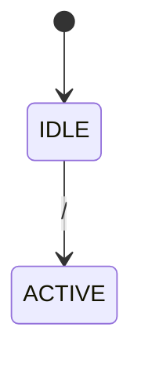
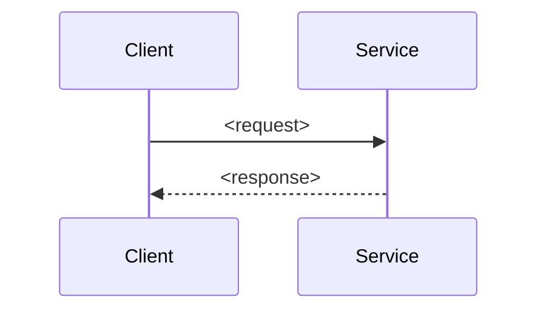

# {{FID}} — <Feature title> — Design

Feature: {{FID}}
Spec: ./spec.md (must be `Status: Approved` before this design is written)
Author: architect-planner
Security-sensitive: no

## 1. Overview

<How the approved requirements are realised, in a few sentences. Reference the architecture
docs and ADRs this design relies on.>

## 2. Modules and ownership

| Component | Module / file | New or changed | Responsibility | Requirements |
|---|---|---|---|---|
| <component> | `<path>` | new | <...> | <ID..ID> |

Dependencies added: none | `<name> <version>` — justification (Articles 10, 11) and licence.

## 3. State machines



State names follow the normative source. Each transition with its requirement:

| From | Event | Guard | Actions (outputs, timers, events) | To | Requirement |
|---|---|---|---|---|---|

## 4. Types and data model

```
// Sketch only: signatures, enums, key fields. No bodies.
```

- Serialisation / persistence: <...>
- Secrets: <which types are wiped on drop, no revealing debug output>.
- Identifiers: <how allocated; deterministic where required>.

## 5. Sequences



## 6. Events / logs / metrics emitted

| Event | Emitted at (module/fn) | Fields | Requirement |
|---|---|---|---|

## 7. Error handling and abnormal cases

| Abnormal case / error | Detection point | Reaction (per source) | Error type | Requirement |
|---|---|---|---|---|

## 8. Performance considerations (Article 8)

- Cost per operation: <...>
- Memory per entity: <estimate>, within the budget.
- Complexity: <no per-operation work proportional to the total entity count; lookups via ...>
- Benchmarks to add/extend and the recorded baseline: <bench name, path>

## 9. Security considerations (Articles 3, 6)

- Untrusted inputs and their bounds: <...>
- Constant-time comparisons: <...>
- Secret lifecycle: <...>
- Security-sensitive: yes/no. If yes: second independent security review, double fix-checks
  and product-owner sign-off are required.

## 10. Test strategy

| Requirement group | Test type (unit/integration/fixture/property/fuzz/contract) | Location | Oracle |
|---|---|---|---|

## 11. Constitution check

| Article | Complies? | Note |
|---|---|---|
| 1 normative source | yes | |
| 2 proportionate, decided | yes | |
| 3 no crash on untrusted input | yes | |
| 4 tests first / traceability | yes | |
| 5 independent oracles | yes | |
| 6 security | yes | |
| 7 <project property> | yes | |
| 8 performance budgets | yes | |
| 9 observability | yes | |
| 10 simplicity | yes | |
| 11 licensing | yes | |
| 12 gates are law | yes | |

### Complexity / Constitution exceptions

<None, or: Article N — what deviates — why it is unavoidable — what limits the damage.
Needs product-owner sign-off in review.md.>

## 12. Risks and open points

| Risk | Likelihood | Impact | Mitigation |
|---|---|---|---|

## 13. Test amendments

<Filled by the test arbiter if a test or snapshot had to change after the red check: which
test, why it was wrong against the spec/source, the quote.>

## 14. Proposed ADR (only if cross-cutting)

<Title, context, decision, consequences. The architect turns this into docs/adr/NNNN-*.md.>
